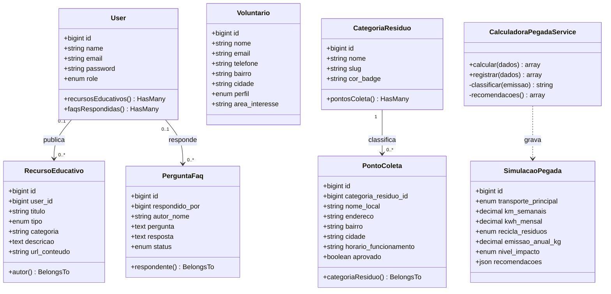
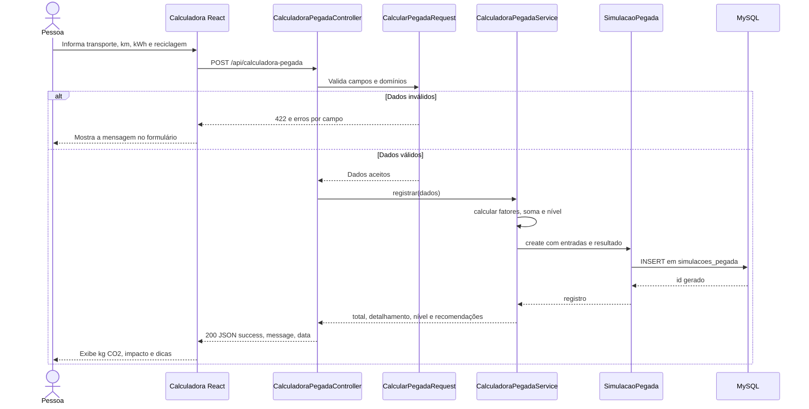
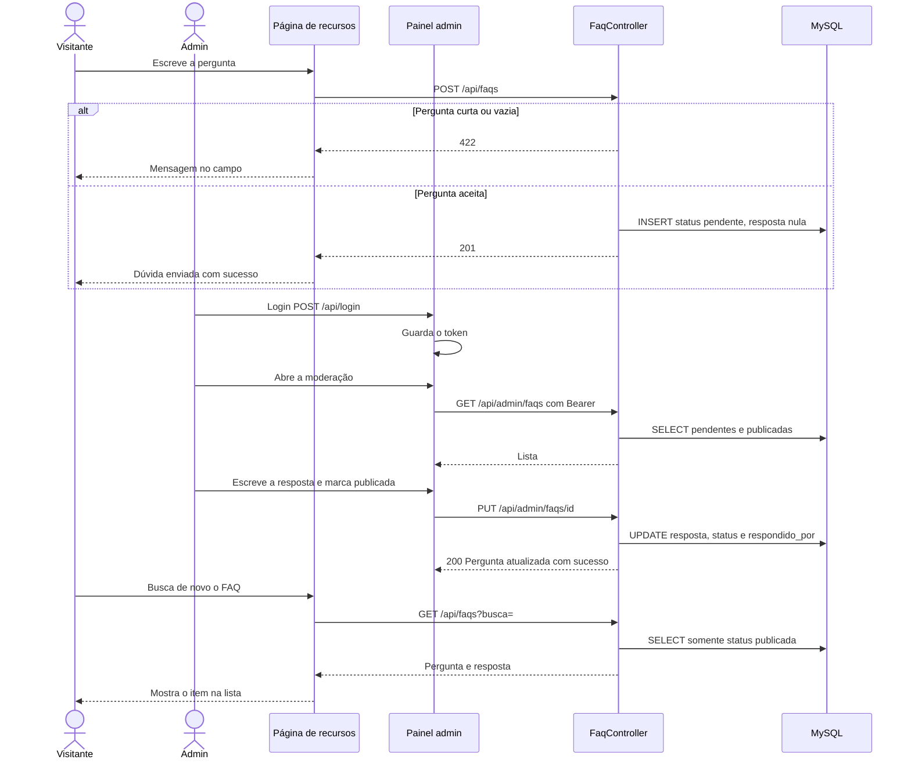
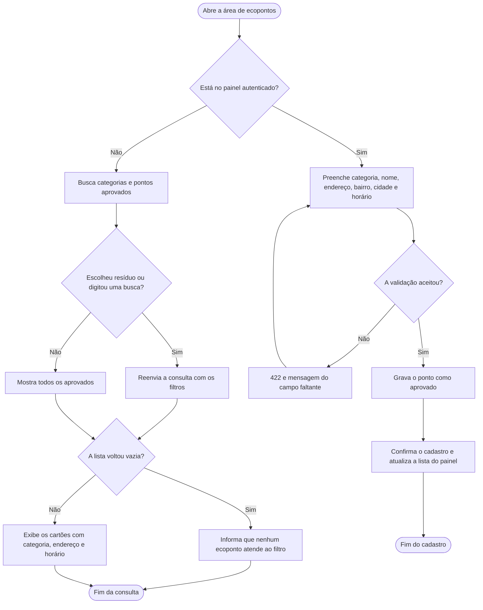
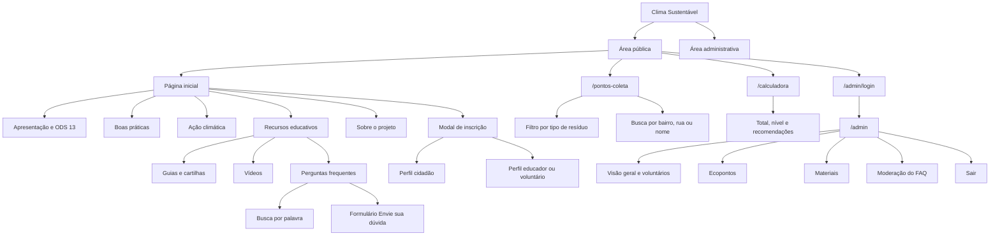
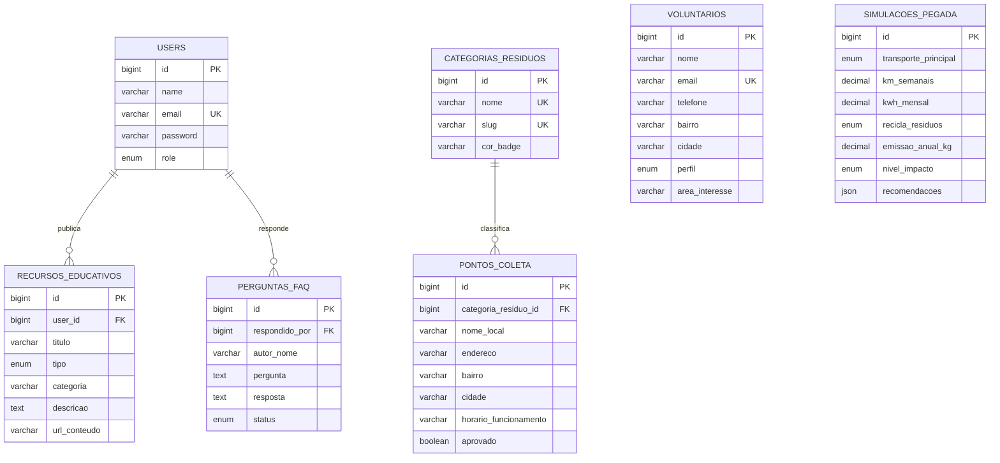

# Situação-Problema 1 — Clima Sustentável

**Projeto Integrador Transdisciplinar em Engenharia de Software II (PITE II)**

Documento de revisão de escopo, modelagem UML, interface humano-computador e projeto de banco de dados da aplicação web Clima Sustentável, alinhada à ODS 13.

O texto descreve o sistema que está no repositório: API Laravel em `back-end/` e interface React em `front-end/`. Os nomes de tabelas e colunas seguem as migrations do projeto.

---

## 1. Revisão de escopo e melhoria contínua (Kaizen)

### 1.1 De onde o projeto veio

Na atividade extensionista anterior, o Clima Sustentável era um site informativo estático, feito em Next.js. O conteúdo explicava práticas de mitigação climática e foi mostrado a 12 moradores da comunidade. A leitura funcionava, mas o visitante não conseguia se inscrever, achar um ecoponto perto de casa, estimar a própria emissão nem deixar uma dúvida para alguém responder.

A autoavaliação e o retorno desses moradores apontaram o mesmo limite: informação sozinha não sustenta a ação local. O PITE II transforma esse portal em uma aplicação com cadastro, consulta, cálculo e uma área de administração, persistida em MySQL e organizada em MVC.

### 1.2 Antes e depois

| Aspecto | MVP anterior (site estático) | Plataforma atual (PITE II) |
| --- | --- | --- |
| Objetivo | Informar sobre a ODS 13 | Informar e permitir ação: inscrição, consulta, cálculo e dúvida |
| Tecnologia | Next.js, páginas fixas | React + Vite + Tailwind no cliente; Laravel 11 e PHP 8+ no servidor |
| Organização | Páginas e componentes de apresentação | MVC: Model, validação, Controller e resposta JSON; regra da pegada em um serviço |
| Dados | Textos escritos no código | MySQL, com tabelas normalizadas e chaves estrangeiras |
| Engajamento | Sem cadastro | Inscrição de cidadão, educador e voluntário |
| Ecopontos | Lista ilustrativa, se houvesse | Consulta real, com filtro por resíduo e por bairro ou texto |
| Pegada de carbono | Explicação geral | Calculadora que grava a simulação, classifica o impacto e devolve recomendações |
| Dúvidas | FAQ fixo | Busca nas perguntas publicadas e envio de dúvida, que fica pendente |
| Administração | Não havia | Login com token, gestão de voluntários, ecopontos, materiais, FAQ e estatísticas |
| Quem valida o conteúdo | Ninguém; o texto já vinha pronto | O administrador publica materiais, responde dúvidas e cadastra ecopontos |
| Retorno ao usuário | A página apenas era exibida | Carregamento, lista vazia, confirmação antes de excluir e aviso de sucesso ou erro |
| Testes | Revisão manual do site | PHPUnit na API, com SQLite em memória |

### 1.3 O que o Kaizen mudou no desenho

Kaizen, aqui, é a revisão pequena e contínua do que a comunidade já tinha visto, em vez de trocar o tema do projeto. O conteúdo educativo permanece. O que entra de novo é o que o teste com os 12 moradores mostrou que faltava: um caminho para participar, um lugar para descartar e uma conta simples da emissão de cada um.

Três decisões saíram dessa revisão:

1. **A inscrição não vira login.** Cidadão, educador e voluntário se cadastram para mutirão e oficina. Só o administrador autentica. Isso evita uma conta para quem só quer deixar o nome e o bairro.
2. **Ecoponto não é cadastrado por qualquer visitante.** A listagem é pública, com filtro. O cadastro, a edição e a exclusão ficam no painel. A primeira ideia era um formulário aberto na página de coleta. Na revisão, isso foi retirado: um ponto falso ou incompleto apareceria para toda a comunidade. O administrador é quem publica o local.
3. **Dúvida nova não entra direto no FAQ.** O visitante envia a pergunta com status `pendente`. Ela só aparece no site depois que o administrador responde e marca `publicada`.

A interface também foi revista em cima do protótipo: textos do rodapé, estados de espera e listas vazias. Esse ponto está na seção 3.

### 1.4 Requisitos funcionais

| ID | Requisito | Quem usa |
| --- | --- | --- |
| RF01 | Consultar a página inicial, com práticas, ação climática e acesso aos materiais educativos (guias e vídeos), com filtro por categoria. | Visitante |
| RF02 | Buscar perguntas frequentes já publicadas por palavra da pergunta ou da resposta. | Visitante |
| RF03 | Enviar uma dúvida. O registro nasce `pendente`, sem resposta, e não aparece na listagem pública. | Visitante |
| RF04 | Inscrever-se como cidadão, educador ou voluntário, informando nome, e-mail, bairro, cidade e área de interesse. O telefone é opcional. O e-mail não pode repetir. | Visitante, educador e voluntário |
| RF05 | Consultar ecopontos aprovados e filtrar por categoria de resíduo e por texto (nome, endereço, bairro ou cidade). | Visitante |
| RF06 | Calcular a pegada anual de CO₂ a partir do transporte, dos km semanais, do consumo de energia e do hábito de reciclagem. O sistema classifica o impacto em baixo, moderado ou alto, grava a simulação e devolve recomendações. | Visitante |
| RF07 | Entrar e sair do painel. O login confere e-mail e senha e devolve um token. O logout invalida o token usado. | Administrador |
| RF08 | Cadastrar, alterar e excluir ecopontos. A listagem pública só mostra registros aprovados. A criação pelo painel grava o ponto como aprovado. | Administrador |
| RF09 | Cadastrar, alterar e excluir guias e vídeos. O autor gravado é o administrador autenticado. | Administrador |
| RF10 | Listar dúvidas pendentes e publicadas, responder, publicar ou excluir. Ao atualizar, o sistema grava quem respondeu. | Administrador |
| RF11 | Listar voluntários, com filtro opcional por perfil, e excluir um cadastro. A exclusão pede confirmação na interface. | Administrador |
| RF12 | Ver as estatísticas das simulações: quantidade, média de emissão e quantas caíram em cada nível de impacto. | Administrador |

### 1.5 Requisitos não funcionais

| ID | Requisito | Como foi atendido |
| --- | --- | --- |
| RNF01 | Arquitetura MVC no servidor | Models em `app/Models`, controllers em `app/Http/Controllers/Api`, validação em `app/Http/Requests`. A conta da pegada fica em `CalculadoraPegadaService`, fora do controller. A interface React consome JSON e não acessa o banco. |
| RNF02 | Persistência relacional em MySQL | As migrations criam as tabelas de domínio com chave primária, unicidade e chave estrangeira. O banco da aplicação é `clima_sustentavel`, em UTF-8. |
| RNF03 | Usabilidade | Rótulos em português, botões com o mesmo desenho, aviso ao concluir uma ação, confirmação antes de excluir, indicação de carregamento e texto quando a lista vem vazia. |
| RNF04 | Autenticação do painel | Laravel Sanctum. As rotas de gestão exigem `Authorization: Bearer {token}`. Visitante não cadastra ecoponto, material nem resposta de FAQ. |
| RNF05 | Erro compreensível | A API responde JSON. Validação volta 422 com a mensagem de cada campo. Sem token, 401. Registro inexistente, 404. Credencial errada, 401 com “Credenciais inválidas.” |
| RNF06 | Testes automatizados da API | PHPUnit cobre cálculo da pegada, voluntário, ecoponto, FAQ, login e recursos. A suíte usa SQLite em memória e não depende do MySQL ligado. |
| RNF07 | Separação entre site e API | O front roda em `http://localhost:5173` e a API em `http://localhost:8000`. O CORS libera essas origens. |
| RNF08 | Integridade dos dados de domínio | E-mail de voluntário e de usuário é único. Ecoponto exige uma categoria existente. Categoria em uso não pode ser apagada (`ON DELETE RESTRICT`). Se o administrador de um material ou de uma resposta for removido, a referência fica nula e o conteúdo permanece. |

---

## 2. Modelagem UML

Os diagramas abaixo estão em Mermaid para o GitHub renderizar neste arquivo. A mesma figura, em PNG, está em `docs/situacao-problema-1/diagramas-uml/`.

### 2.1 Casos de uso

Há três atores. O visitante usa o site sem conta. O educador e o voluntário também não entram no painel: a diferença é o perfil escolhido na inscrição (RF04). O administrador é o único que autentica.

```mermaid
flowchart TB
    visitante([Visitante / Cidadão])
    equipe([Educador / Voluntário])
    admin([Administrador])

    ucConteudo[Consultar conteúdos educativos]
    ucFaq[Consultar FAQ publicado]
    ucDuvida[Enviar dúvida]
    ucEngajar[Inscrever-se para ação comunitária]
    ucPontos[Consultar ecopontos]
    ucFiltro[Filtrar ecopontos]
    ucPegada[Calcular pegada de carbono]
    ucValidar[Validar dados do formulário]
    ucLogin[Autenticar no painel]
    ucVoluntarios[Gerenciar voluntários]
    ucEcoponto[Gerenciar ecopontos]
    ucRecurso[Gerenciar recursos educativos]
    ucModerar[Responder e publicar FAQ]
    ucEstatistica[Consultar estatísticas das simulações]

    visitante --> ucConteudo
    visitante --> ucFaq
    visitante --> ucDuvida
    visitante --> ucEngajar
    visitante --> ucPontos
    visitante --> ucPegada
    equipe --> ucEngajar
    equipe --> ucConteudo
    equipe --> ucPontos
    equipe --> ucPegada

    admin --> ucLogin
    ucVoluntarios -.->|include| ucLogin
    ucEcoponto -.->|include| ucLogin
    ucRecurso -.->|include| ucLogin
    ucModerar -.->|include| ucLogin
    ucEstatistica -.->|include| ucLogin
    admin --> ucVoluntarios
    admin --> ucEcoponto
    admin --> ucRecurso
    admin --> ucModerar
    admin --> ucEstatistica

    ucFiltro -.->|extend| ucPontos
    ucDuvida -.->|include| ucValidar
    ucEngajar -.->|include| ucValidar
    ucPegada -.->|include| ucValidar
    ucEcoponto -.->|include| ucValidar
    ucModerar -.->|extend| ucFaq
```

`<<include>>` marca um passo que o caso de uso sempre executa. `<<extend>>` marca um caminho que só ocorre em uma condição.



**Leitura do diagrama.** Consultar ecopontos pode ser só abrir a lista. Filtrar estende esse caso quando a pessoa escolhe um resíduo ou digita um bairro. Enviar dúvida, inscrever-se, calcular a pegada e salvar um ecoponto sempre passam pela validação. Responder o FAQ estende a consulta pública: a pergunta só entra nessa consulta depois de publicada. As funções do painel incluem a autenticação. Sem token válido, a API recusa a operação.

#### Especificação do caso de uso: calcular a pegada de carbono

| Campo | Descrição |
| --- | --- |
| Nome | Calcular pegada de carbono |
| Ator | Visitante, educador ou voluntário |
| Pré-condição | A página da calculadora está aberta e a API está no ar |
| Pós-condição | Existe uma linha em `simulacoes_pegada` e a tela mostra total, nível e recomendações |

**Fluxo principal**

1. A pessoa informa o transporte principal, os km semanais, o kWh mensal e se recicla sempre, às vezes ou nunca.
2. A interface envia `POST /api/calculadora-pegada`.
3. O `CalcularPegadaRequest` aceita os dados.
4. O `CalculadoraPegadaService` calcula transporte (`km × 52 × fator`), energia (`kWh × 12 × 0,085`) e resíduos (100, 250 ou 450 kg).
5. A soma é arredondada em duas casas. Abaixo de 1500 kg o impacto é baixo; de 1500 a 3500, moderado; acima de 3500, alto.
6. O serviço grava a simulação e o controller devolve 200 com o detalhamento e as recomendações.
7. A tela mostra o resultado.

**Fluxo alternativo.** A pessoa usa bicicleta ou caminhada. O fator de transporte é zero. O restante do cálculo segue igual.

**Fluxo de exceção.** Falta um campo, a quilometragem é negativa ou passa de 10000, o consumo passa de 50000 kWh, ou o transporte e o hábito não estão na lista permitida. A API responde 422 com “Erro de validação nos dados enviados.” e a mensagem do campo. Nada é gravado.

#### Especificação do caso de uso: enviar dúvida e publicar resposta

| Campo | Descrição |
| --- | --- |
| Nome | Enviar dúvida e publicar resposta |
| Atores | Visitante envia; administrador publica |
| Pré-condição do envio | O painel de FAQ da página inicial está aberto |
| Pré-condição da resposta | O administrador está autenticado |
| Pós-condição | A pergunta publicada aparece em `GET /api/faqs` |

**Fluxo principal**

1. O visitante escreve a pergunta, com no mínimo 10 e no máximo 1000 caracteres. O nome é opcional.
2. A interface envia `POST /api/faqs`.
3. O sistema grava `status = pendente` e `resposta = null`.
4. A tela confirma: “Dúvida enviada com sucesso! Ela será analisada por nossos educadores.”
5. O administrador abre a moderação, escreve a resposta e muda o status para `publicada`.
6. `PUT /api/admin/faqs/{id}` grava a resposta, o status e o id do administrador em `respondido_por`.
7. A partir daí a pergunta entra na busca pública.

**Fluxo alternativo.** O administrador mantém a pergunta como pendente, só para completar o texto depois. Ela continua fora do site público.

**Fluxo de exceção.** A pergunta vem vazia ou curta demais: 422 e “A pergunta deve ter no mínimo 10 caracteres.” Se o administrador perdeu o token, o `PUT` volta 401 e a interface manda de novo para `/admin/login`.

#### Especificação do caso de uso: consultar e filtrar ecopontos

| Campo | Descrição |
| --- | --- |
| Nome | Consultar ecopontos |
| Ator | Qualquer visitante |
| Pré-condição | Existem categorias de resíduo cadastradas |
| Pós-condição | A tela lista só pontos com `aprovado = true` que atendem ao filtro |

**Fluxo principal**

1. A pessoa abre `/pontos-coleta`.
2. A interface busca as categorias e os pontos aprovados.
3. Os cartões mostram nome, endereço, bairro, cidade, horário e a cor da categoria.

**Fluxo alternativo — filtro.** A pessoa escolhe um tipo de resíduo ou pesquisa por bairro, rua ou nome. A busca é refeita. Se não houver resultado, a tela diz: “Nenhum ecoponto encontrado para esse filtro. Tente outro tipo de resíduo ou outro bairro.”

**Fluxo de exceção.** A API não responde. O aviso pede para verificar se o back-end está em execução. Nenhum cartão é inventado na tela.

O cadastro de um ponto novo não faz parte deste caso de uso. Ele pertence a “Gerenciar ecopontos” e exige o administrador.

### 2.2 Diagrama de classes

As classes abaixo são as do domínio persistido, mais o serviço que concentra a regra da pegada. Controllers e FormRequests existem na aplicação, mas só orquestram e validam: não guardam estado de negócio.



**Responsabilidade de cada classe**

- **User.** Conta de quem administra o painel. A senha fica hasheada e não volta no JSON. O papel previsto é `admin`.
- **Voluntario.** Inscrição comunitária. Não autentica. O perfil distingue cidadão, educador e voluntário. Não há ligação com `users`: são pessoas diferentes, com objetivos diferentes.
- **CategoriaResiduo.** Tipo de resíduo (recicláveis, eletrônicos, óleo, pilhas, orgânicos), com nome único, slug único e cor do selo. Existe para o ecoponto não repetir esses dados.
- **PontoColeta.** Local de entrega. Guarda endereço e horário e aponta para uma categoria. `aprovado` decide se o site público mostra o cartão.
- **SimulacaoPegada.** Uma execução da calculadora. Guarda as entradas e o resultado. O detalhe por fonte (transporte, energia, resíduos) é recalculado na resposta, porque deriva desses campos.
- **CalculadoraPegadaService.** Aplica os fatores, classifica o impacto, monta as recomendações e pede a gravação. O controller não contém a fórmula.
- **RecursoEducativo.** Guia ou vídeo. `user_id` pode ficar nulo se o autor for removido; o material continua no ar.
- **PerguntaFaq.** Dúvida da comunidade. `respondido_por` aponta para o administrador e também pode ficar nulo. Enquanto `status` é `pendente`, a listagem pública ignora a linha.

**Cardinalidade**

- Um usuário publica zero ou muitos recursos. Um recurso tem no máximo um autor.
- Um usuário responde zero ou muitas perguntas. Uma pergunta tem no máximo um respondente.
- Uma categoria classifica zero ou muitos ecopontos. Um ecoponto tem exatamente uma categoria.
- Voluntário e simulação não dependem de outra entidade de domínio. Por isso não há losango ligando essas classes a `User`.

### 2.3 Sequência: calculadora de pegada



A tela não calcula a emissão sozinha. Se a fórmula mudar, a alteração fica no serviço e os testes de unidade conferem o número. O exemplo de conferência usado no projeto é 120 km semanais de carro, 210 kWh e reciclagem às vezes: 1.310,40 kg de transporte, 214,20 kg de energia, 250 kg de resíduos, total de 1.774,60 kg e impacto moderado.

### 2.4 Sequência: dúvida do visitante e publicação pelo administrador



Entre o envio e a publicação, a pergunta existe no banco e no painel, mas o `GET /api/faqs` não a devolve. Essa separação é o que impede uma pergunta sem revisão de aparecer para a comunidade.

### 2.5 Atividades: consulta, filtro e cadastro de ecoponto



O visitante não chega no formulário de cadastro. A página pública só percorre o ramo da esquerda. O ramo da direita é o “Novo ponto” do painel. Se o administrador desmarca `aprovado` numa edição, o ponto deixa de aparecer na consulta pública.

---

## 3. Projeto de interface humano-computador

### 3.1 Mapa do site



A navegação principal leva à página inicial, aos ecopontos e à calculadora. O login do administrador não divide a atenção do visitante: fica numa rota própria. Dentro da home, guias, vídeos e FAQ são painéis da mesma seção, para a pessoa não perder o contexto da página.

### 3.2 Diretrizes usadas na interface

**Clareza.** Os nomes da interface são os da tarefa: “Quero me engajar”, “Pontos de coleta”, “Calculadora”. Categorias de resíduo aparecem com o nome e a cor cadastrados, não com um código.

**Consistência.** Botões, cartões e avisos repetem o mesmo verde e o mesmo raio de borda. O painel usa as mesmas abas para listar, criar e editar. Mensagens de sucesso e de erro saem no mesmo tipo de aviso.

**Controle.** Dá para fechar o modal de inscrição, limpar um filtro escolhendo outro resíduo e cancelar uma exclusão. O administrador só apaga um registro depois de confirmar. Sair do painel volta para a tela de login e esquece o token.

**Prevenção de erro.** Campos obrigatórios são validados antes de gravar. O e-mail duplicado é recusado. A pergunta do FAQ tem tamanho mínimo, para evitar um envio vazio. O visitante não vê botão de cadastrar ecoponto, então não completa um formulário que a API iria recusar.

**Feedback.** Enquanto a lista carrega, a tela mostra um esqueleto em vez de um vazio falso. Lista sem item explica o que fazer em seguida. O cadastro de voluntário confirma na hora. Erro de campo aparece no próprio campo e também no aviso.

**Revisão em relação ao protótipo.** Dois textos do rodapé estavam errados e foram corrigidos: “Dessarte Seguro” passou a “Descarte Seguro” e “Guías” passou a “Guias”. Esses links levam, respectivamente, à página de ecopontos e à seção de guias. Também entraram o estado de carregamento, o estado vazio de cada lista e a confirmação antes de excluir no painel. O selo da ODS 13 na abertura é uma marca desenhada para a página, com o número 13, para a pessoa reconhecer o tema sem depender de um arquivo externo.

### 3.3 Mensagens de erro e de confirmação

A frase geral da validação é “Erro de validação nos dados enviados.” O campo traz a mensagem específica. Quando a API não responde, a interface usa “Não foi possível conectar à API. Verifique se o back-end está em execução.”

| Ação | Condição | HTTP | O que a pessoa vê |
| --- | --- | --- | --- |
| Inscrição de voluntário | Cadastro aceito | 201 | “Voluntário cadastrado com sucesso.” |
| Inscrição de voluntário | E-mail repetido | 422 | “Este e-mail já está cadastrado.” |
| Inscrição de voluntário | E-mail em formato inválido | 422 | “Informe um e-mail válido.” |
| Inscrição de voluntário | Nome com menos de 3 caracteres | 422 | “O nome deve ter no mínimo 3 caracteres.” |
| Inscrição de voluntário | Perfil fora da lista | 422 | “O perfil deve ser cidadao, educador ou voluntario.” |
| Inscrição de voluntário | Bairro, cidade ou área de interesse ausente | 422 | “O bairro é obrigatório.”, “A cidade é obrigatória.” ou “A área de interesse é obrigatória.” |
| Consulta de ecopontos | Filtro sem resultado | 200 | “Nenhum ecoponto encontrado para esse filtro. Tente outro tipo de resíduo ou outro bairro.” |
| Cadastro de ecoponto | Aceito no painel | 201 | “Ponto de coleta cadastrado com sucesso.” |
| Cadastro de ecoponto | Campo obrigatório vazio | 422 | Mensagem do campo, por exemplo “O nome do local é obrigatório.” |
| Cadastro de ecoponto | Categoria inexistente | 422 | “A categoria de resíduo é obrigatória.” ou erro de existência da chave |
| Cadastro de ecoponto | Visitante sem token | 401 | “Não autenticado. Faça login para continuar.” A tela de login é aberta. |
| Edição ou exclusão de ecoponto | Concluída | 200 | “Ponto de coleta atualizado com sucesso.” ou “Ponto de coleta removido com sucesso.” |
| Exclusão no painel | A pessoa ainda não confirmou | — | Diálogo de confirmação. Cancelar não chama a API. |
| Calculadora | Cálculo gravado | 200 | “Cálculo de pegada de carbono realizado com sucesso.” e o resultado na tela |
| Calculadora | Transporte inválido | 422 | “O transporte principal informado não é válido.” |
| Calculadora | Km ou kWh ausente, negativo ou acima do limite | 422 | Mensagem do campo, com o máximo permitido |
| Calculadora | Hábito de reciclagem inválido | 422 | “O hábito de reciclagem deve ser sempre, as_vezes ou nunca.” |
| Envio de dúvida | Aceito | 201 | “Dúvida enviada com sucesso! Ela será analisada por nossos educadores.” |
| Envio de dúvida | Pergunta vazia | 422 | “A pergunta é obrigatória.” |
| Envio de dúvida | Pergunta com menos de 10 caracteres | 422 | “A pergunta deve ter no mínimo 10 caracteres.” |
| Busca do FAQ | Nenhuma publicada combina | 200 | “Nenhuma pergunta publicada combina com essa busca.” |
| Materiais | Filtro sem item | 200 | “Nenhum material encontrado para esse filtro.” |
| Login | E-mail e senha corretos | 200 | “Login realizado com sucesso.” e abertura do painel |
| Login | Senha ou e-mail incorretos | 401 | “Credenciais inválidas.” |
| Login | E-mail vazio ou senha vazia | 422 | “O e-mail é obrigatório.” ou “A senha é obrigatória.” |
| Logout | Token revogado | 200 | “Logout realizado com sucesso.” |
| Rota do painel | Sem token ou token inválido | 401 | “Não autenticado. Faça login para continuar.” |
| Qualquer recurso por id | Registro não existe | 404 | “Recurso não encontrado.” |
| Painel, lista de voluntários | Ainda não há inscrições | 200 | “Nenhum voluntário inscrito ainda.” |
| Painel, materiais ou pontos | Lista vazia | 200 | “Nenhum recurso cadastrado.” ou “Nenhum ponto aprovado.” |
| Painel, FAQ | Filtro sem dúvida | 200 | “Nenhuma dúvida nesse filtro.” |

---

## 4. Projeto de banco de dados

O banco de domínio tem sete tabelas: `users`, `voluntarios`, `categorias_residuos`, `pontos_coleta`, `simulacoes_pegada`, `recursos_educativos` e `perguntas_faq`. O Laravel ainda cria tabelas de sessão, cache, fila, redefinição de senha e os tokens do Sanctum (`personal_access_tokens`). Elas sustentam o framework e o login. Não entram no modelo climático e ficam de fora do dicionário abaixo.

### 4.1 Modelo conceitual



Voluntários e simulações ficam isolados de propósito. A inscrição não é uma conta, e a calculadora não exige identificar quem simulou. As duas ligações com `users` são opcionais do lado do filho: o recurso e a pergunta continuam se o usuário for apagado.

### 4.2 Esquema relacional e formas normais

```text
users (id PK, name, email UQ, password, role, created_at, updated_at)

voluntarios (id PK, nome, email UQ, telefone, bairro, cidade, perfil, area_interesse, created_at, updated_at)

categorias_residuos (id PK, nome UQ, slug UQ, cor_badge, created_at, updated_at)

pontos_coleta (id PK, categoria_residuo_id FK, nome_local, endereco, bairro, cidade, horario_funcionamento, aprovado, created_at, updated_at)

simulacoes_pegada (id PK, transporte_principal, km_semanais, kwh_mensal, recicla_residuos, emissao_anual_kg, nivel_impacto, recomendacoes, created_at, updated_at)

recursos_educativos (id PK, user_id FK, titulo, tipo, categoria, descricao, url_conteudo, created_at, updated_at)

perguntas_faq (id PK, respondido_por FK, autor_nome, pergunta, resposta, status, created_at, updated_at)
```

**1FN.** Cada coluna guarda um valor só. Não há lista de bairros dentro de um campo, nem várias categorias no mesmo ecoponto. O JSON de `recomendacoes` guarda uma lista de textos produzida junta, como um atributo do resultado. Não é uma relação que se consulta campo a campo. Nome, e-mail e endereço ocupam colunas próprias.

**2FN.** Toda tabela usa uma chave primária simples (`id`). Não há chave composta, então não existe atributo que dependa só de parte da chave. Os campos de `pontos_coleta` descrevem aquele ponto, não “a categoria mais o ponto”.

**3FN.** Um atributo que não é chave não determina outro atributo que não é chave. O nome e a cor da categoria não ficam repetidos em `pontos_coleta`: ficam em `categorias_residuos`, e o ponto guarda só `categoria_residuo_id`. O nome do administrador não é copiado para o recurso nem para a resposta; fica a chave `user_id` ou `respondido_por`. O nível de impacto é gravado junto da simulação porque é o resultado daquela conta, não uma entidade com vida própria. Os fatores (0,21 kg/km, 0,085 kg/kWh) não são colunas: vivem no serviço, para não duplicar regra no banco.

### 4.3 Script físico (MySQL)

```sql
CREATE DATABASE IF NOT EXISTS clima_sustentavel
  CHARACTER SET utf8mb4
  COLLATE utf8mb4_unicode_ci;

USE clima_sustentavel;

CREATE TABLE users (
  id BIGINT UNSIGNED NOT NULL AUTO_INCREMENT,
  name VARCHAR(120) NOT NULL,
  email VARCHAR(150) NOT NULL,
  password VARCHAR(255) NOT NULL,
  role ENUM('admin') NOT NULL DEFAULT 'admin',
  created_at TIMESTAMP NULL DEFAULT NULL,
  updated_at TIMESTAMP NULL DEFAULT NULL,
  PRIMARY KEY (id),
  UNIQUE KEY users_email_unique (email)
) ENGINE=InnoDB;

CREATE TABLE voluntarios (
  id BIGINT UNSIGNED NOT NULL AUTO_INCREMENT,
  nome VARCHAR(120) NOT NULL,
  email VARCHAR(150) NOT NULL,
  telefone VARCHAR(20) NULL,
  bairro VARCHAR(100) NOT NULL,
  cidade VARCHAR(100) NOT NULL,
  perfil ENUM('cidadao', 'educador', 'voluntario') NOT NULL DEFAULT 'cidadao',
  area_interesse VARCHAR(150) NOT NULL,
  created_at TIMESTAMP NULL DEFAULT NULL,
  updated_at TIMESTAMP NULL DEFAULT NULL,
  PRIMARY KEY (id),
  UNIQUE KEY voluntarios_email_unique (email)
) ENGINE=InnoDB;

CREATE TABLE categorias_residuos (
  id BIGINT UNSIGNED NOT NULL AUTO_INCREMENT,
  nome VARCHAR(80) NOT NULL,
  slug VARCHAR(80) NOT NULL,
  cor_badge VARCHAR(20) NOT NULL DEFAULT '#1E5631',
  created_at TIMESTAMP NULL DEFAULT NULL,
  updated_at TIMESTAMP NULL DEFAULT NULL,
  PRIMARY KEY (id),
  UNIQUE KEY categorias_residuos_nome_unique (nome),
  UNIQUE KEY categorias_residuos_slug_unique (slug)
) ENGINE=InnoDB;

CREATE TABLE pontos_coleta (
  id BIGINT UNSIGNED NOT NULL AUTO_INCREMENT,
  categoria_residuo_id BIGINT UNSIGNED NOT NULL,
  nome_local VARCHAR(150) NOT NULL,
  endereco VARCHAR(255) NOT NULL,
  bairro VARCHAR(100) NOT NULL,
  cidade VARCHAR(100) NOT NULL,
  horario_funcionamento VARCHAR(120) NOT NULL,
  aprovado TINYINT(1) NOT NULL DEFAULT 1,
  created_at TIMESTAMP NULL DEFAULT NULL,
  updated_at TIMESTAMP NULL DEFAULT NULL,
  PRIMARY KEY (id),
  CONSTRAINT pontos_coleta_categoria_residuo_id_foreign
    FOREIGN KEY (categoria_residuo_id) REFERENCES categorias_residuos (id)
    ON DELETE RESTRICT
) ENGINE=InnoDB;

CREATE TABLE simulacoes_pegada (
  id BIGINT UNSIGNED NOT NULL AUTO_INCREMENT,
  transporte_principal ENUM('carro_combustao', 'moto', 'transporte_publico', 'bicicleta_caminhada') NOT NULL,
  km_semanais DECIMAL(8,2) NOT NULL,
  kwh_mensal DECIMAL(8,2) NOT NULL,
  recicla_residuos ENUM('sempre', 'as_vezes', 'nunca') NOT NULL,
  emissao_anual_kg DECIMAL(10,2) NOT NULL,
  nivel_impacto ENUM('baixo', 'moderado', 'alto') NOT NULL,
  recomendacoes JSON NOT NULL,
  created_at TIMESTAMP NULL DEFAULT NULL,
  updated_at TIMESTAMP NULL DEFAULT NULL,
  PRIMARY KEY (id)
) ENGINE=InnoDB;

CREATE TABLE recursos_educativos (
  id BIGINT UNSIGNED NOT NULL AUTO_INCREMENT,
  user_id BIGINT UNSIGNED NULL,
  titulo VARCHAR(180) NOT NULL,
  tipo ENUM('guia', 'video') NOT NULL,
  categoria VARCHAR(80) NOT NULL,
  descricao TEXT NOT NULL,
  url_conteudo VARCHAR(255) NOT NULL,
  created_at TIMESTAMP NULL DEFAULT NULL,
  updated_at TIMESTAMP NULL DEFAULT NULL,
  PRIMARY KEY (id),
  CONSTRAINT recursos_educativos_user_id_foreign
    FOREIGN KEY (user_id) REFERENCES users (id)
    ON DELETE SET NULL
) ENGINE=InnoDB;

CREATE TABLE perguntas_faq (
  id BIGINT UNSIGNED NOT NULL AUTO_INCREMENT,
  respondido_por BIGINT UNSIGNED NULL,
  autor_nome VARCHAR(120) NULL,
  pergunta TEXT NOT NULL,
  resposta TEXT NULL,
  status ENUM('pendente', 'publicada') NOT NULL DEFAULT 'pendente',
  created_at TIMESTAMP NULL DEFAULT NULL,
  updated_at TIMESTAMP NULL DEFAULT NULL,
  PRIMARY KEY (id),
  CONSTRAINT perguntas_faq_respondido_por_foreign
    FOREIGN KEY (respondido_por) REFERENCES users (id)
    ON DELETE SET NULL
) ENGINE=InnoDB;
```

Na aplicação, o mesmo esquema é criado pelas migrations (`php artisan migrate`). O script acima serve para leitura e para recriar só o domínio em um MySQL vazio. A senha de `users` deve ser gravada como hash, nunca em texto puro. Quem for usar o painel precisa também da tabela de tokens do Sanctum, criada pela migration do framework.

### 4.4 Dicionário de dados

#### users

Conta do administrador do painel.

| Campo | Tipo de dado / tamanho | Nulo? | Chave (PK/FK/UQ) | Valor padrão | Domínio / restrições de integridade | Descrição funcional |
| --- | --- | --- | --- | --- | --- | --- |
| id | BIGINT UNSIGNED | Não | PK | Auto incremento | Identificador interno | Identifica o administrador |
| name | VARCHAR(120) | Não | — | — | Até 120 caracteres | Nome exibido no painel |
| email | VARCHAR(150) | Não | UQ | — | E-mail único, usado no login | Credencial de acesso |
| password | VARCHAR(255) | Não | — | — | Hash bcrypt. A API não devolve este campo | Senha do administrador |
| role | ENUM('admin') | Não | — | admin | Somente o valor `admin` | Papel da conta |
| created_at | TIMESTAMP | Sim | — | NULL | Preenchido pelo framework na inclusão | Data de criação |
| updated_at | TIMESTAMP | Sim | — | NULL | Atualizado pelo framework na alteração | Data da última alteração |

#### voluntarios

Inscrição para mutirão, oficina ou ação comunitária. Não serve para login.

| Campo | Tipo de dado / tamanho | Nulo? | Chave (PK/FK/UQ) | Valor padrão | Domínio / restrições de integridade | Descrição funcional |
| --- | --- | --- | --- | --- | --- | --- |
| id | BIGINT UNSIGNED | Não | PK | Auto incremento | Identificador interno | Identifica a inscrição |
| nome | VARCHAR(120) | Não | — | — | Na API, mínimo de 3 caracteres | Nome de quem se inscreveu |
| email | VARCHAR(150) | Não | UQ | — | E-mail válido e único na tabela | Contato e trava contra inscrição duplicada |
| telefone | VARCHAR(20) | Sim | — | NULL | Até 20 caracteres | Telefone opcional |
| bairro | VARCHAR(100) | Não | — | — | Até 100 caracteres | Bairro de atuação |
| cidade | VARCHAR(100) | Não | — | — | Até 100 caracteres | Cidade de atuação |
| perfil | ENUM('cidadao','educador','voluntario') | Não | — | cidadao | Só esses três valores | Papel na ação comunitária |
| area_interesse | VARCHAR(150) | Não | — | — | Até 150 caracteres. Exemplos: Mutirão de Plantio, Oficinas Educativas, Coleta Seletiva | Tema em que a pessoa quer ajudar |
| created_at | TIMESTAMP | Sim | — | NULL | A listagem do painel ordena por esta coluna, da mais nova para a mais antiga | Data da inscrição |
| updated_at | TIMESTAMP | Sim | — | NULL | Atualizado se o registro for alterado | Data da última alteração |

#### categorias_residuos

Tipos de resíduo usados pelos ecopontos.

| Campo | Tipo de dado / tamanho | Nulo? | Chave (PK/FK/UQ) | Valor padrão | Domínio / restrições de integridade | Descrição funcional |
| --- | --- | --- | --- | --- | --- | --- |
| id | BIGINT UNSIGNED | Não | PK | Auto incremento | Referenciado por `pontos_coleta.categoria_residuo_id` | Identifica a categoria |
| nome | VARCHAR(80) | Não | UQ | — | Único. Exemplos: Recicláveis, Eletrônicos, Óleo de Cozinha, Pilhas e Baterias, Orgânicos | Nome mostrado no filtro e no cartão |
| slug | VARCHAR(80) | Não | UQ | — | Único, estável, sem acento | Identificador textual da categoria |
| cor_badge | VARCHAR(20) | Não | — | #1E5631 | Cor em hexadecimal | Cor do selo na interface |
| created_at | TIMESTAMP | Sim | — | NULL | — | Data de criação |
| updated_at | TIMESTAMP | Sim | — | NULL | — | Data da última alteração |

#### pontos_coleta

Locais de entrega de resíduos. A listagem pública ignora a linha quando `aprovado` é falso.

| Campo | Tipo de dado / tamanho | Nulo? | Chave (PK/FK/UQ) | Valor padrão | Domínio / restrições de integridade | Descrição funcional |
| --- | --- | --- | --- | --- | --- | --- |
| id | BIGINT UNSIGNED | Não | PK | Auto incremento | Identificador interno | Identifica o ecoponto |
| categoria_residuo_id | BIGINT UNSIGNED | Não | FK | — | Deve existir em `categorias_residuos.id`. ON DELETE RESTRICT: a categoria não sai enquanto houver ponto | Tipo de resíduo aceito no local |
| nome_local | VARCHAR(150) | Não | — | — | Até 150 caracteres | Nome do ecoponto |
| endereco | VARCHAR(255) | Não | — | — | Até 255 caracteres | Logradouro e número |
| bairro | VARCHAR(100) | Não | — | — | Participa do filtro `bairro` e da busca textual | Bairro do local |
| cidade | VARCHAR(100) | Não | — | — | Participa da busca textual | Município |
| horario_funcionamento | VARCHAR(120) | Não | — | — | Texto livre, até 120 caracteres | Dias e horários de funcionamento |
| aprovado | TINYINT(1) | Não | — | 1 (verdadeiro) | A consulta pública só devolve verdadeiro. O cadastro pelo painel grava verdadeiro | Controla a visibilidade no site |
| created_at | TIMESTAMP | Sim | — | NULL | — | Data de criação |
| updated_at | TIMESTAMP | Sim | — | NULL | — | Data da última alteração |

#### simulacoes_pegada

Cada uso da calculadora gera uma linha. Não há identificação da pessoa.

| Campo | Tipo de dado / tamanho | Nulo? | Chave (PK/FK/UQ) | Valor padrão | Domínio / restrições de integridade | Descrição funcional |
| --- | --- | --- | --- | --- | --- | --- |
| id | BIGINT UNSIGNED | Não | PK | Auto incremento | Identificador interno | Identifica a simulação |
| transporte_principal | ENUM | Não | — | — | `carro_combustao`, `moto`, `transporte_publico`, `bicicleta_caminhada` | Meio de transporte informado |
| km_semanais | DECIMAL(8,2) | Não | — | — | Na API, de 0 a 10000 | Quilômetros percorridos por semana |
| kwh_mensal | DECIMAL(8,2) | Não | — | — | Na API, de 0 a 50000 | Consumo mensal de energia |
| recicla_residuos | ENUM | Não | — | — | `sempre`, `as_vezes`, `nunca` | Hábito de separação dos resíduos |
| emissao_anual_kg | DECIMAL(10,2) | Não | — | — | Soma arredondada em duas casas | Emissão anual estimada, em kg de CO₂ |
| nivel_impacto | ENUM | Não | — | — | `baixo` se menor que 1500; `moderado` de 1500 a 3500; `alto` se maior que 3500 | Classificação mostrada à pessoa |
| recomendacoes | JSON | Não | — | — | Lista de textos gerada pelo serviço | Dicas ligadas aos maiores contribuintes da conta |
| created_at | TIMESTAMP | Sim | — | NULL | Entra na média e na contagem do painel | Data da simulação |
| updated_at | TIMESTAMP | Sim | — | NULL | — | Data da última alteração |

#### recursos_educativos

Guias, cartilhas e vídeos exibidos na página inicial.

| Campo | Tipo de dado / tamanho | Nulo? | Chave (PK/FK/UQ) | Valor padrão | Domínio / restrições de integridade | Descrição funcional |
| --- | --- | --- | --- | --- | --- | --- |
| id | BIGINT UNSIGNED | Não | PK | Auto incremento | Identificador interno | Identifica o material |
| user_id | BIGINT UNSIGNED | Sim | FK | NULL | Referencia `users.id`. ON DELETE SET NULL | Administrador que publicou. Fica nulo se a conta for removida |
| titulo | VARCHAR(180) | Não | — | — | Até 180 caracteres | Título do guia ou do vídeo |
| tipo | ENUM('guia','video') | Não | — | — | Só esses dois valores. A interface filtra por ele | Distingue cartilha e vídeo |
| categoria | VARCHAR(80) | Não | — | — | Texto livre. Exemplos: Resíduos, Energia, Transporte, Arborização | Assunto usado no filtro |
| descricao | TEXT | Não | — | — | Texto obrigatório | Resumo do material |
| url_conteudo | VARCHAR(255) | Não | — | — | URL com até 255 caracteres | Endereço do conteúdo |
| created_at | TIMESTAMP | Sim | — | NULL | — | Data de publicação |
| updated_at | TIMESTAMP | Sim | — | NULL | — | Data da última alteração |

#### perguntas_faq

Dúvidas enviadas pela comunidade e respostas do administrador.

| Campo | Tipo de dado / tamanho | Nulo? | Chave (PK/FK/UQ) | Valor padrão | Domínio / restrições de integridade | Descrição funcional |
| --- | --- | --- | --- | --- | --- | --- |
| id | BIGINT UNSIGNED | Não | PK | Auto incremento | Identificador interno | Identifica a pergunta |
| respondido_por | BIGINT UNSIGNED | Sim | FK | NULL | Referencia `users.id`. ON DELETE SET NULL. Preenchido no PUT administrativo com o id autenticado | Administrador que respondeu |
| autor_nome | VARCHAR(120) | Sim | — | NULL | Até 120 caracteres | Nome de quem enviou, se quiser informar |
| pergunta | TEXT | Não | — | — | Na API, de 10 a 1000 caracteres | Texto da dúvida |
| resposta | TEXT | Sim | — | NULL | Permanece nula enquanto pendente | Resposta publicada |
| status | ENUM('pendente','publicada') | Não | — | pendente | O GET público só devolve `publicada` | Controla se a dúvida aparece no site |
| created_at | TIMESTAMP | Sim | — | NULL | — | Data do envio |
| updated_at | TIMESTAMP | Sim | — | NULL | Muda quando a resposta é gravada | Data da última alteração |

---

## Figuras exportadas

| Figura | Arquivo |
| --- | --- |
| Casos de uso | `diagramas-uml/casos-de-uso.png` |
| Classes | `diagramas-uml/classes.png` |
| Sequência da calculadora | `diagramas-uml/sequencia-calculadora.png` |
| Sequência do FAQ | `diagramas-uml/sequencia-faq.png` |
| Atividades dos ecopontos | `diagramas-uml/atividades-ecopontos.png` |
| Mapa de navegação | `diagramas-uml/mapa-navegacao.png` |
| DER | `diagramas-uml/der.png` |

A versão consolidada para leitura e envio está em `documentacao-projeto.pdf`, nesta mesma pasta.
